# Cryptographic Request Integrity and Authentication Framework: Architecture Specification

## 1. Overview
The **Cryptographic Request Integrity and Authentication Framework** demonstrates how REST APIs mitigate tampering, unauthorized forgery, replay attacks, and side-channel vulnerabilities using symmetric cryptographic primitives.

By leveraging **HMAC-SHA256** (Hash-based Message Authentication Code with SHA-256) combined with **canonical representation binding**, **cryptographic nonces**, **freshness windows**, and **constant-time comparisons**, the protocol guarantees:
- **Authentication**: Proof that the request originated from an entity possessing the shared secret key.
- **Integrity**: Mathematical certainty that the HTTP Method, URI path, query parameters, timestamp, nonce, and request payload have not been altered in transit.
- **Freshness & Anti-Replay**: Guarantee that intercepted requests cannot be reused beyond a bounded time window or submitted twice.
- **Side-Channel Resistance**: Immunity against microsecond timing attacks during signature verification.

---

## 2. Cryptographic Canonical Representation

HTTP requests are inherently non-deterministic due to varied header ordering, query parameter permutations, and optional whitespace. Before calculating or verifying signatures, both Client and Server derive the **Canonical String** using strict rules:

$$\text{CanonicalString} = \text{METHOD} \parallel \texttt{\\n} \parallel \text{PATH} \parallel \texttt{\\n} \parallel \text{SORTED\_QUERY} \parallel \texttt{\\n} \parallel \text{TIMESTAMP} \parallel \texttt{\\n} \parallel \text{NONCE} \parallel \texttt{\\n} \parallel \text{SHA256(BODY)}$$

### Canonicalization Specification Table

| Component | Format / Transformation | Example | Purpose |
| :--- | :--- | :--- | :--- |
| **Method** | Uppercase ASCII string (`GET`, `POST`, `PUT`, `DELETE`) | `POST` | Binds the HTTP action |
| **Path** | Absolute normalized URI path (leading `/`, no trailing `/`) | `/api/v1/payments/transfer` | Prevents route alterations |
| **Sorted Query** | Parameters sorted alphabetically by key, then value; joined by `&` | `currency=USD&notify=true&priority=high` | Prevents query parameter reordering |
| **Timestamp** | Unix Epoch timestamp in seconds (`Math.floor(Date.now() / 1000)`) | `1771661400` | Freshness bounding |
| **Nonce** | 128-bit cryptographically secure random hexadecimal string | `a4f89d3c1b6e5f0d2c8a7e1b4f9d0c2e` | Single-use anti-replay token |
| **Body SHA-256** | Lowercase 64-char hexadecimal digest of request body string | `4a3b7...` (or empty string digest `e3b0c44...`) | Payload integrity binding |

### Output Security Headers

The client attaches the following headers to the outgoing HTTP transaction:

```http
X-Timestamp: 1771661400
X-Nonce: a4f89d3c1b6e5f0d2c8a7e1b4f9d0c2e
X-Signature: 5bdcc146bf60754e6a04242608957504ac33e8b15d01a99d024b1e45a8002d0f
X-Key-Id: client-app-prod-01
Content-Type: application/json
```

---

## 3. End-to-End Cryptographic Sequence Diagram

The following Mermaid sequence diagram illustrates the lifecycle of a request: normal client submission, an interception/tampering attempt by an attacker (Eve), and server-side verification.

```mermaid
sequenceDiagram
    autonumber
    actor Alice as Client (Alice)
    actor Eve as Attacker (Eve / MitM)
    participant Server as API Server (Verifier)

    Note over Alice: 1. Generate Nonce & Timestamp<br/>2. Compute SHA-256(Body)<br/>3. Build Canonical String<br/>4. Compute HMAC-SHA256(SecretKey, CanonicalString)
    Alice->>Eve: Transmit Signed Request via Network

    rect rgb(30, 41, 59)
        Note over Eve: Adversary Attempts Attack Scenarios:<br/>• Scenario 1: Tamper Body ($2500 -> $2500000)<br/>• Scenario 2: Replay identical captured request<br/>• Scenario 3: Delay request past tolerance window<br/>• Scenario 4: Sign with rogue key
    end

    Eve->>Server: Forward (Tampered or Replayed) Request

    Note over Server: Server Verification Pipeline:
    alt Step 1: Missing Required Headers
        Server-->>Eve: 400 Bad Request (Missing X-Timestamp/Nonce/Sig)
    else Step 2: |ServerTime - Timestamp| > Window
        Server-->>Eve: 401 Unauthorized (Request Timestamp Expired)
    else Step 3: Nonce exists in Server Cache
        Server-->>Eve: 409 Conflict / 401 Unauthorized (Replay Detected)
    else Step 4 & 5: Recompute Canonical & Constant-Time HMAC Check Fails
        Server-->>Eve: 401 Unauthorized (Signature Mismatch / Tampering)
    else All Checks Pass (Legitimate Alice Request)
        Note over Server: Record Nonce into Cache with TTL<br/>Execute Business Logic
        Server-->>Alice: 200 OK (Transaction Processed Successfully)
    end
```



---

## 4. Server Verification Pipeline Flowchart

The simulated server verifier processes requests through a strict, multi-stage decision pipeline. Failure at any stage halts processing immediately without committing database transactions or consuming computational resources on subsequent steps.

```mermaid
flowchart TD
    Start([Incoming HTTP Request]) --> Step1{Step 1: Check Headers<br/>X-Timestamp, X-Nonce, X-Signature}

    Step1 -- Missing any header --> Reject1[❌ Reject: 400 Missing Headers]
    Step1 -- All Present --> Step2{Step 2: Freshness Window<br/>|ServerNow - Timestamp| &le; Tolerance}

    Step2 -- Skew > Tolerance --> Reject2[❌ Reject: 401 Timestamp Expired / Clock Skew]
    Step2 -- Valid Freshness --> Step3{Step 3: Nonce Cache Check<br/>Has Nonce been seen in active TTL?}

    Step3 -- Nonce in Cache --> Reject3[❌ Reject: 409 Replay Attack Detected]
    Step3 -- Nonce Novel --> Step4[Step 4: Reconstruct Canonical String<br/>• Sort query params<br/>• SHA-256(Body)<br/>• Normalize path]

    Step4 --> Step5[Step 5: Compute Server HMAC-SHA256<br/>HMAC(ServerSecretKey, CanonicalString)]
    Step5 --> Step6{Step 6: Constant-Time Comparison<br/>constantTimeEqual(ExpectedSig, ReceivedSig)}

    Step6 -- Mismatch --> Reject4[❌ Reject: 401 Invalid Signature / Tampering]
    Step6 -- Match --> Success[Step 7: Record Nonce into Cache with TTL<br/>✅ Accept: 200 OK Authenticated & Intact]
```

---

## 5. Threat Mitigation Matrix

| Threat | Attack Mechanism | Countermeasure in Framework | Rejection Step |
| :--- | :--- | :--- | :--- |
| **Payload Tampering** | Attacker intercepts JSON in flight and alters fields (e.g. transfer amount or beneficiary). | Body is bound to the canonical string via SHA-256. Any single byte change produces a completely different hash ($2^{256}$ search space). | **Step 5** (Signature Mismatch) |
| **Replay Attack** | Attacker intercepts a valid request packet and resends it repeatedly to duplicate transfers. | Every request contains a unique 128-bit cryptographic nonce stored in a server memory cache with TTL. | **Step 3** (Duplicate Nonce Found) |
| **Stale / Delayed Replay** | Attacker captures a signed request and replays it hours or days later after cache eviction. | Timestamp freshness window (default ±60s) rejects requests whose timestamp drift exceeds the threshold, bounding cache memory requirements. | **Step 2** (Timestamp Expired) |
| **Credential Forgery** | Attacker attempts to forge requests using guessed or rogue secret keys. | HMAC-SHA256 guarantees unforgeability without knowledge of the pre-shared secret key. | **Step 5** (Signature Mismatch) |
| **Route / Query Tampering** | Attacker changes `GET /api/v1/profile` to `DELETE /api/v1/admin/users`. | The HTTP Method, normalized path, and sorted query string are explicitly bound into the canonical string. | **Step 5** (Signature Mismatch) |
| **Side-Channel Timing Leak** | Attacker measures sub-microsecond CPU timing variations of `stringA === stringB` to deduce signature bytes. | `constantTimeEqual()` evaluates every byte using bitwise XOR accumulation without early loop termination. | **Mitigated** (Constant execution cycles) |

---

## 6. Implementation Notes & Standards Compliance

- **HMAC Specification**: FIPS PUB 198-1 and RFC 2104.
- **SHA-256 Hash**: FIPS PUB 180-4.
- **Test Vectors**: Verified against RFC 4231 (Test Vector 2 with key `"Jefe"`).
- **Web Cryptography API**: Built exclusively on standard browser-native `window.crypto.subtle` without third-party libraries.
